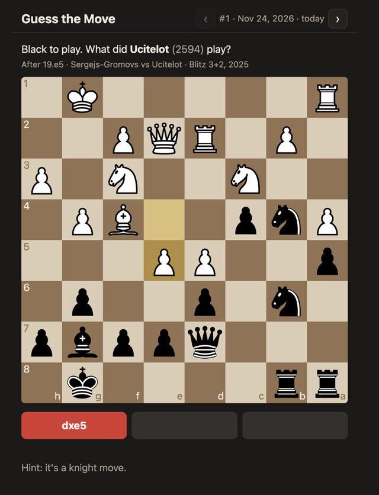
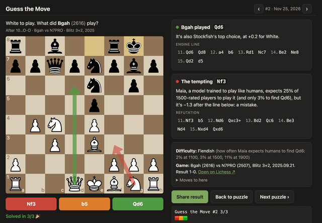
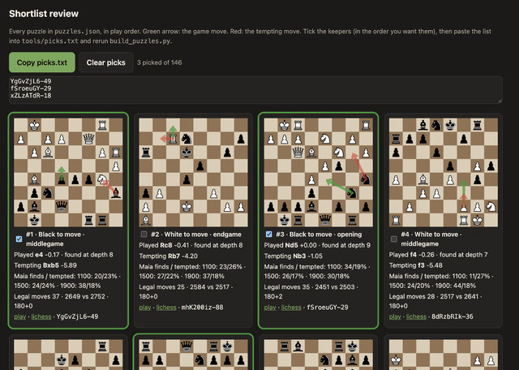

# Guess the Move

<a href="screenshots/puzzle.jpg"></a>
<a href="screenshots/reveal.jpg"></a>
<a href="screenshots/review.jpg"></a>

**▶ Play in your browser:** [catchouli.github.io/guess-the-move](https://catchouli.github.io/guess-the-move/)

A daily chess puzzle, a bit like Wordle. Every day there's one position from a real game between strong players, and you get three tries to find the move they actually played. Each guess is graded by Stockfish, so even a miss tells you whether you were close, and after a miss you get a hint: first which piece moved, then which square it moved from.

When you're done you see the move that was played and the engine's line for it, plus the tempting move most people would reach for and how it gets punished. Then there's a grid of coloured squares to share, so you can compare with your friends without spoiling it.

Most chess puzzles are tactics: there's a forced line and you either see it or you don't. I wanted one about judgement instead, the kind of quiet move a strong player finds because they understand the position, where the obvious move looks fine and isn't.

It's very much a prototype right now. The puzzles come from one month of games, there's no streak counter yet, and you can flick through every puzzle with the arrows rather than waiting a day for the next one.

## Picking the positions

This is the hard part. Almost every position in a game makes a bad puzzle: it's still opening theory, or there's only one sensible move (taking back a piece), or the game's already won, or there are three equally good moves so there's no right answer.

The puzzles come from the [Lichess Elite Database](https://database.nikonoel.fr/), games between strong players (2400 and up against 2200 and up). A Python script plays through each game and throws out positions that are still in the book (move sequences lots of other games reached too), checks, recaptures and positions where someone's already more than two pawns up. Stockfish then looks at what's left, and a position stays only if:

- the move that was played is Stockfish's top choice, or level with it,
- it's clearly better than the next best move, so there's a real answer,
- there are still a few reasonable moves, so it isn't forced,
- and there's a tempting move that's clearly worse (a pawn or more).

The interesting bit is working out which move is *tempting*, and whether the right move is hard to find. The first idea was to ask Stockfish at a low depth, on the theory that a shallow search is a bit like a human glancing at the board. It isn't. Modern Stockfish is far stronger than any person even at depth 2, so its "tempting" moves were often ones no human would play, and plenty of the puzzles were easy anyway.

So instead it uses [Maia](https://maiachess.com), a set of neural nets trained to predict what human players at a given rating actually play. The script asks Maia at 1100, 1500 and 1900 how likely people are to play each move, and keeps positions where few people would find the game move and a lot of them would go for a different, worse one. That's where the reveal's "Maia expects 25% of 1500-rated players to play this" comes from, and it's what sets the difficulty. It also finds about twice as many puzzles per game, roughly one in every 17.

The script ranks the positions, and `review.html` shows them all on one page for picking the good ones by hand and putting them in order.

## Running it locally

The site is plain HTML and JavaScript with no build step, using [cm-chessboard](https://github.com/shaack/cm-chessboard) for the board and [chess.js](https://github.com/jhlywa/chess.js) for the rules:

```sh
python3 -m http.server -d site
```

Then open http://localhost:8000. Pushing to `main` deploys `site/` to GitHub Pages.

## Making puzzles

You'll need Stockfish, [lc0](https://lczero.org) to run Maia, and the Maia weights:

```sh
brew install stockfish lc0
python3 -m venv .venv && .venv/bin/pip install chess numpy
gh release download -R CSSLab/maia-chess v1.0 -p 'maia-1[159]00.pb.gz' -D maia

curl -O https://database.nikonoel.fr/lichess_elite_2025-09.zip && unzip lichess_elite_2025-09.zip
```

Then find candidates and turn them into the puzzle list:

```sh
.venv/bin/python tools/filter.py lichess_elite_2025-09.pgn --games 2500 \
  --tempting maia --maia-weights maia/maia-1100.pb.gz maia/maia-1500.pb.gz maia/maia-1900.pb.gz \
  -o tools/out/candidates-maia.json
.venv/bin/python tools/build_puzzles.py tools/out/candidates-maia.json -o site/puzzles.json
```

2500 games take about half an hour on a 16 core machine. `--offset N` skips games an earlier run already looked at, and `--tempting shallow` uses the original low-depth Stockfish idea instead of Maia, if you want to compare. To choose and order the puzzles yourself, tick them on the review page, paste the list into `tools/picks.txt` and run `build_puzzles.py` again.

The original plan, with the reasoning behind all the checks, is in [PLAN.md](PLAN.md).
